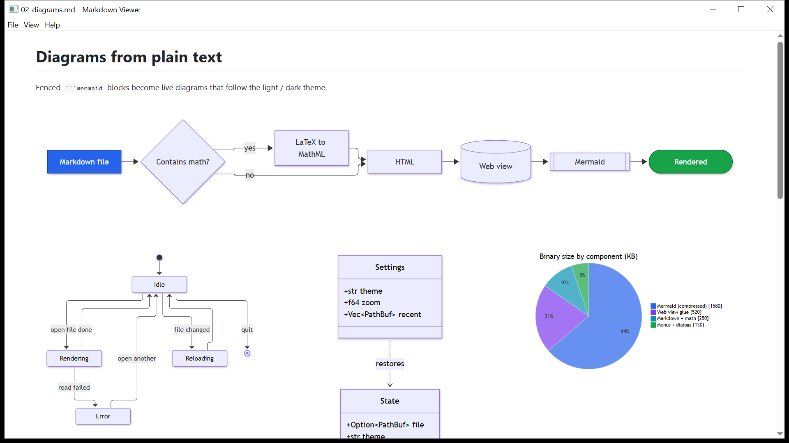
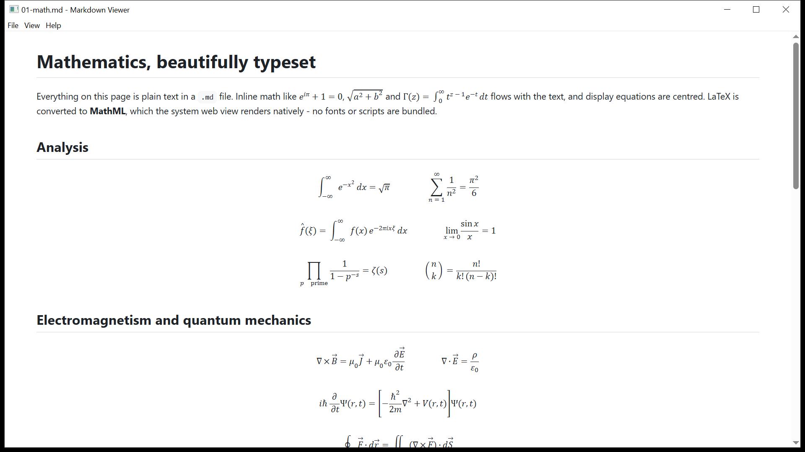
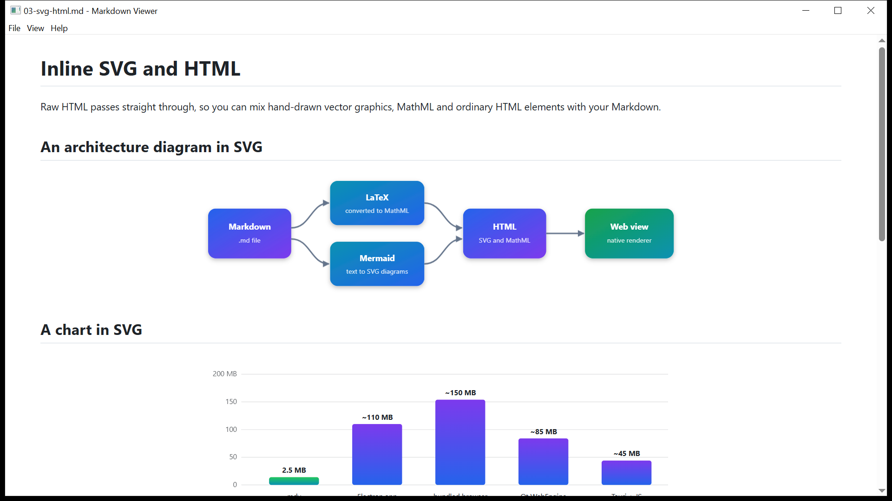
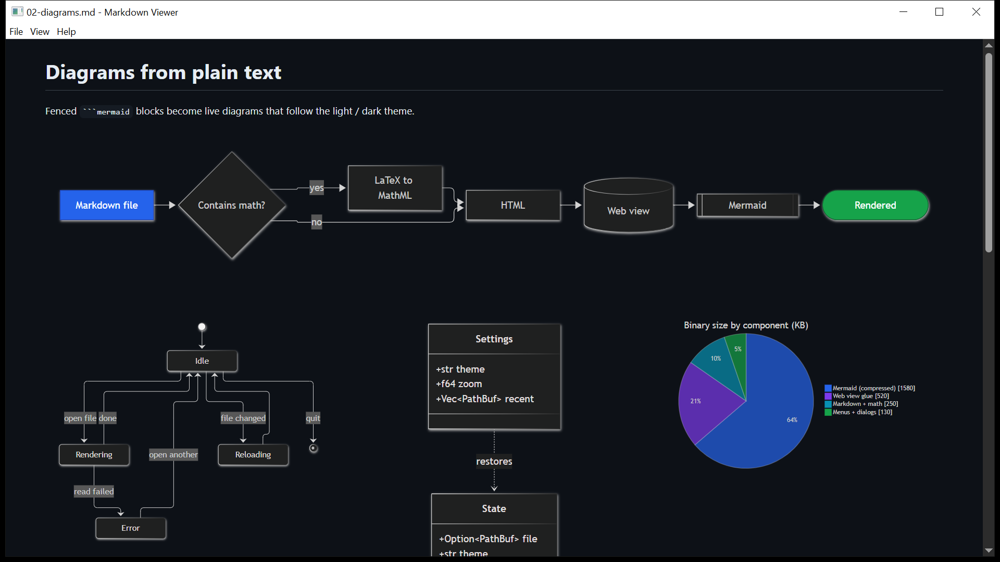
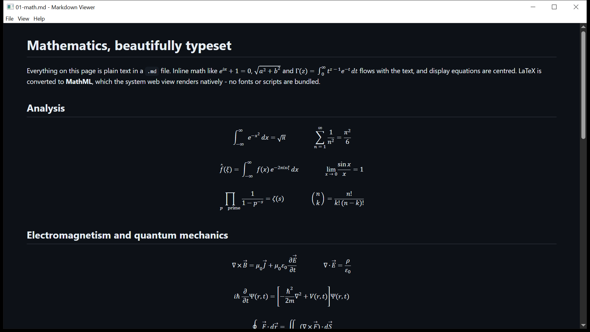

# mdv - Markdown Viewer

A tiny cross-platform (Windows, Linux, macOS) Markdown viewer with real math and real diagrams. The release binary is
about 2.6 MB because it uses the operating system's webview (WebView2 / WebKitGTK / WKWebView) instead of bundling a browser.

## Features

- **Markdown:** tables, footnotes, task lists, strikethrough, heading attributes, sub/superscript
- **LaTeX:** `$inline$` and `$$display$$`, converted to MathML in Rust (no fonts or JavaScript shipped)
  - fractions, roots, sums/integrals/limits, matrices (`pmatrix`, `bmatrix`, `vmatrix`, ...), accents, `\text`, `\binom`, ...
  - multi-line and table environments: `cases`, `aligned`, `align`, `gathered`, `split`, `multline`, `array` (with `\hline` and `|` rules)
  - errors are shown inline next to the formula instead of breaking the page
- **Mermaid:** diagrams in ```` ```mermaid ```` blocks (flowchart, sequence, class, state, ER, Gantt, pie, mind map, ...);
  the library is embedded compressed, loaded only when needed, works offline and follows the light/dark theme
  - **LaTeX inside diagrams:** write `$$...$$` in a label, e.g. `A["$$E = mc^2$$"]`. Flowchart, state, class, ER and similar
    labels get real typeset math; labels that can only hold plain text (sequence-diagram messages, axes) get a Unicode approximation
- **HTML:** raw HTML, inline SVG and MathML pass straight through (scripts run too - only open files you trust)
- **Desktop:** open dialog, drag and drop, file association, live reload on save, recent files, find, zoom, print / save as PDF,
  light/dark/system theme (theme, zoom and recent files are remembered), relative images, links between `.md` files
- **Updates:** downloadable builds check GitHub Releases once a day and show a notice (Help menu to turn off or check
  now); Microsoft Store builds never do, the Store updates them



| | |
|---|---|
|  |  |
|  |  |

## Install

Download from the [latest release](https://github.com/sunaram/markdown-viewer/releases/latest):

| File | For |
|---|---|
| `mdv.exe` | Windows, portable (needs the WebView2 runtime, preinstalled on Windows 11) |
| `mdv.msix` | Windows package (the Microsoft Store build) |
| Linux `.tar.gz` | Linux, with `install.sh` for a per-user install |
| macOS `.dmg` | macOS (ad-hoc signed: right-click > Open the first time) |

## Usage

```sh
mdv notes.md        # open a file; with no argument it reopens the last one
```

| Shortcut | Action |
|---|---|
| Ctrl+O / Ctrl+R / F5 | open / reload |
| Ctrl+F, F3 / Shift+F3 | find, next / previous |
| Ctrl + `+` / `-` / `0` | zoom in / out / reset |
| Ctrl+P | print / save as PDF |
| Ctrl+E | open the file in your default editor |
| Ctrl+W | quit |

(Cmd instead of Ctrl on macOS.) Settings are stored in `%APPDATA%\mdv` (Windows), `~/.config/mdv` (Linux) or
`~/Library/Application Support/mdv` (macOS).

`samples/` has the documents shown above plus `04-latex-advanced.md` (`cases`, `aligned`, `array`, math inside Mermaid)
and `showcase.md`, one long file that exercises everything. `tools/screenshot.ps1` regenerates the screenshots from the
real app (Windows).

## Build

```sh
cargo build --release          # Linux needs libwebkit2gtk-4.1-dev libgtk-3-dev libxdo-dev
target/release/mdv README.md
```

`assets/mermaid.js.z` is the deflate-compressed `mermaid.min.js`. To update it:

```sh
npm pack mermaid && tar -xzf mermaid-*.tgz package/dist/mermaid.min.js && cp package/dist/mermaid.min.js tools/
node tools/pack.mjs
```

## Packaging (`packaging/`)

| Platform | How |
|---|---|
| Windows (Microsoft Store) | `packaging/msix/build.ps1` builds an MSIX; see the header of that script for Store and local-test usage |
| Windows (direct) | `packaging/windows/install.ps1` (per-user, no extra tools) or `mdv.iss` (Inno Setup) |
| Linux | `packaging/linux/install.sh` (per-user; installs the binary, `.desktop` entry and icon, sets the Markdown MIME default) |
| macOS | `packaging/macos/bundle.sh` builds `Markdown Viewer.app` and a `.dmg` |

`.github/workflows/build.yml` builds all three on every push and publishes a release when a `v*` tag is pushed. The
Store identity comes from the repository variables `MSIX_IDENTITY`, `MSIX_PUBLISHER`, `MSIX_DISPLAY_NAME` and
`MSIX_PUBLISHER_DISPLAY`. The icons are placeholders.

## Privacy

No telemetry, no accounts, and your documents never leave your device. The only network request the app makes itself is
the optional update check in the downloadable builds - see [PRIVACY.md](PRIVACY.md).

## License

MIT - see [LICENSE](LICENSE). The embedded Mermaid library is also MIT-licensed.
