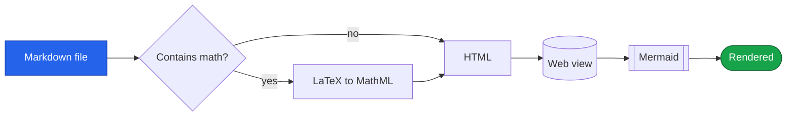
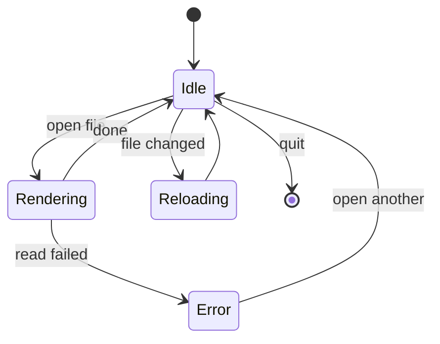
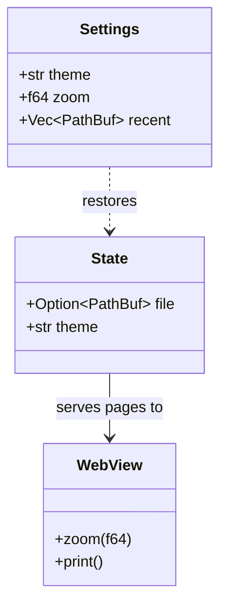
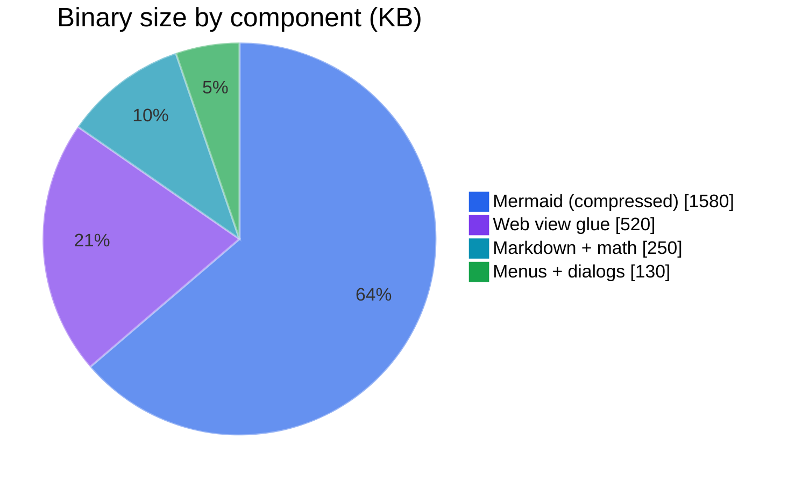
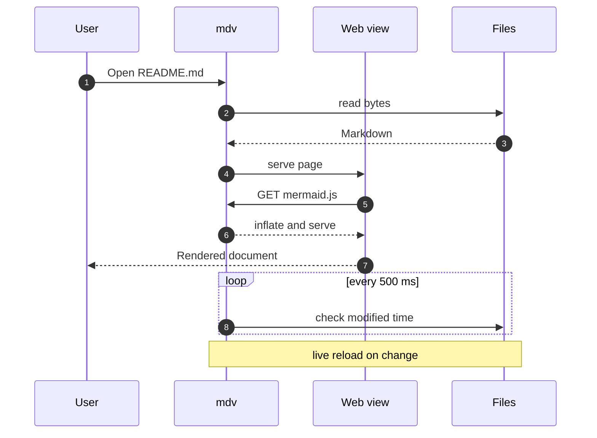
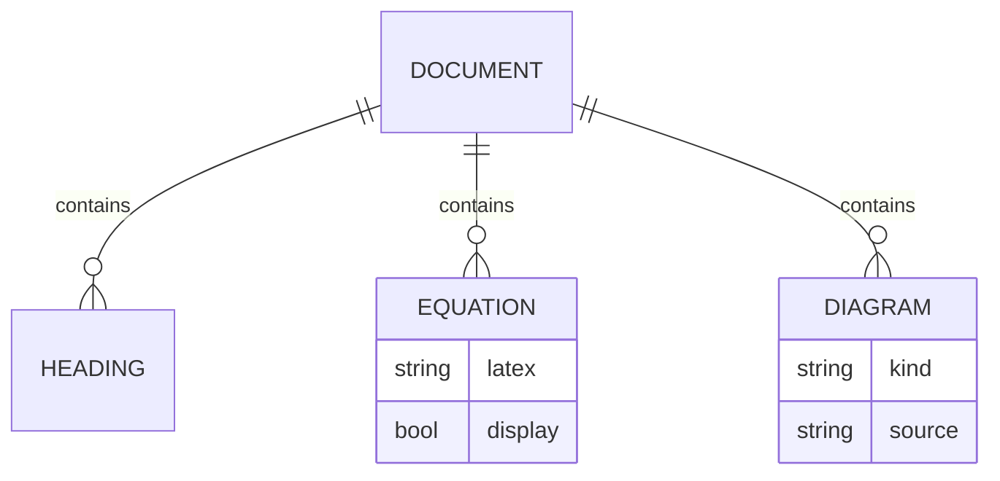
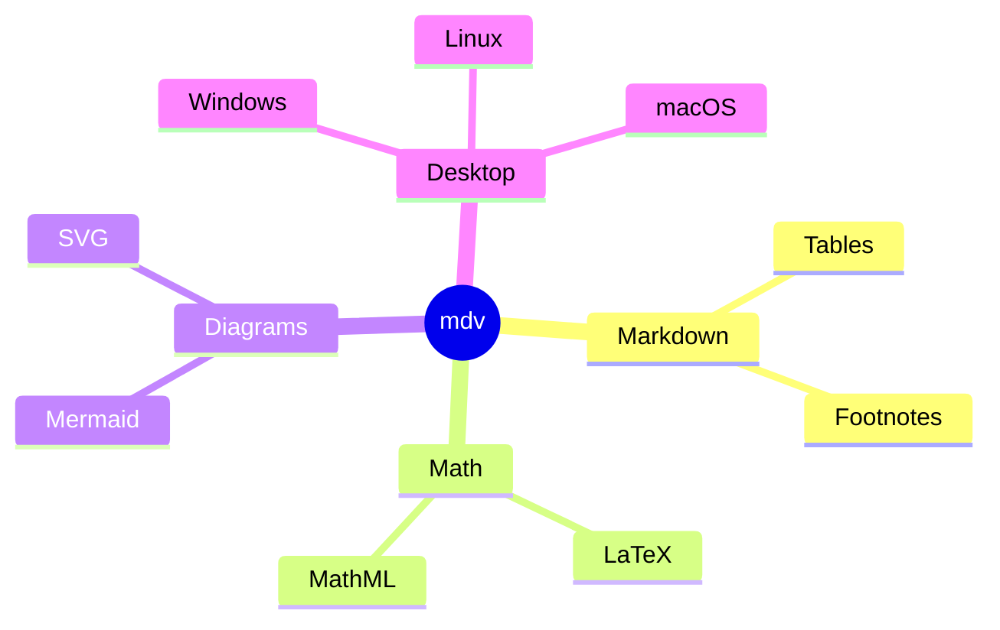
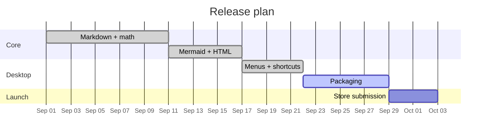

# Diagrams from plain text

Fenced ` ```mermaid ` blocks become live diagrams that follow the light / dark theme.

<div style="display:grid;grid-template-columns:repeat(3,1fr);gap:24px;align-items:start">

<div style="grid-column:span 3">



</div>

<div>



</div>

<div>



</div>

<div>



</div>

<div>



</div>

<div>



</div>

<div>



</div>

<div style="grid-column:span 2">



</div>

</div>
