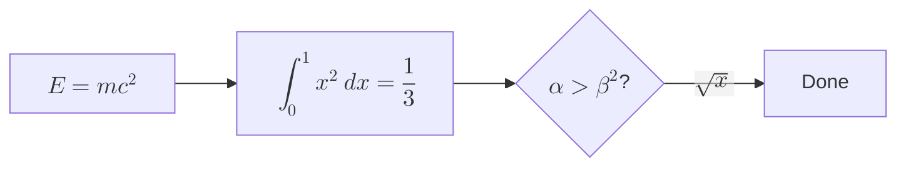
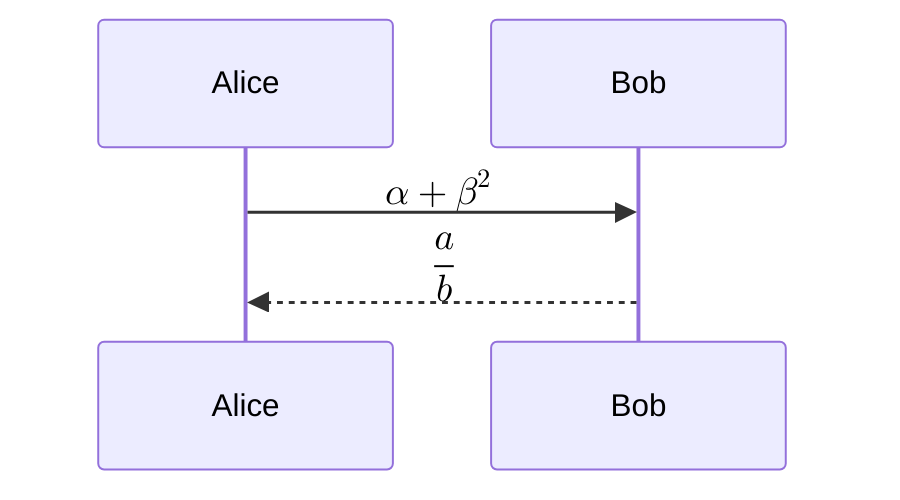

# Advanced LaTeX

## Piecewise (`cases`)

$$
|x| = \begin{cases} x & \text{if } x \ge 0 \\ -x & \text{if } x < 0 \end{cases}
$$

## Aligned derivation (`aligned`)

$$
\begin{aligned}
(a+b)^2 &= (a+b)(a+b) \\
        &= a^2 + 2ab + b^2 \\
\nabla \cdot \vec{E} &= \frac{\rho}{\varepsilon_0}
\end{aligned}
$$

## Arrays with rules (`array`)

$$
\begin{array}{|c|c|c|}
\hline
x & y & x \oplus y \\ \hline
0 & 0 & 0 \\
0 & 1 & 1 \\
1 & 1 & 0 \\ \hline
\end{array}
$$

## Matrices and more

$$
A = \begin{bmatrix} 1 & 2 \\ 3 & 4 \end{bmatrix},\quad
\det A = \begin{vmatrix} 1 & 2 \\ 3 & 4 \end{vmatrix} = -2,\quad
\sum_{\substack{i<n \\ j<m}} a_{ij}
$$

Inline: $\sin x + \lim_{n\to\infty}\left(1+\frac1n\right)^n = e$, and $\binom{n}{k}$, $\sqrt[3]{8}=2$.

## LaTeX inside Mermaid

