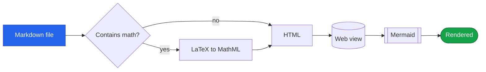
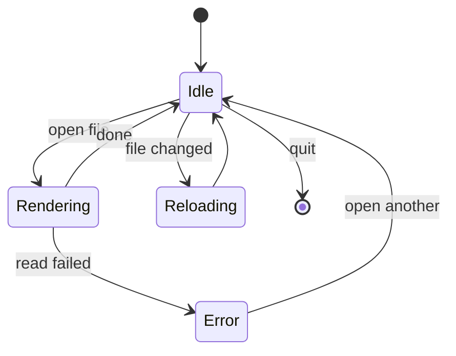
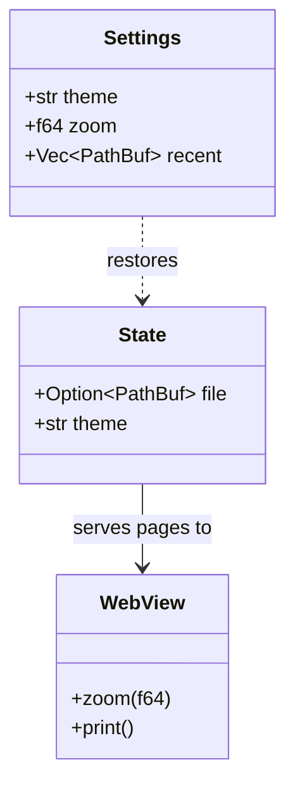
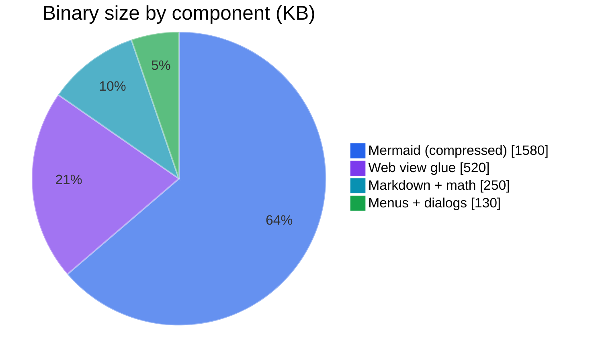
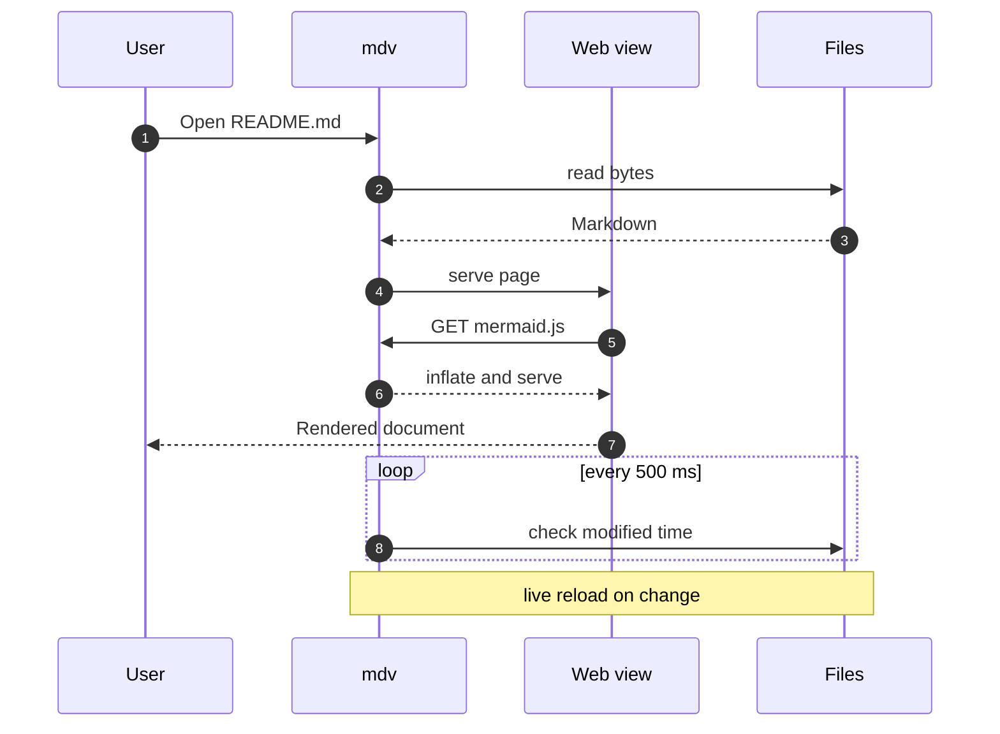
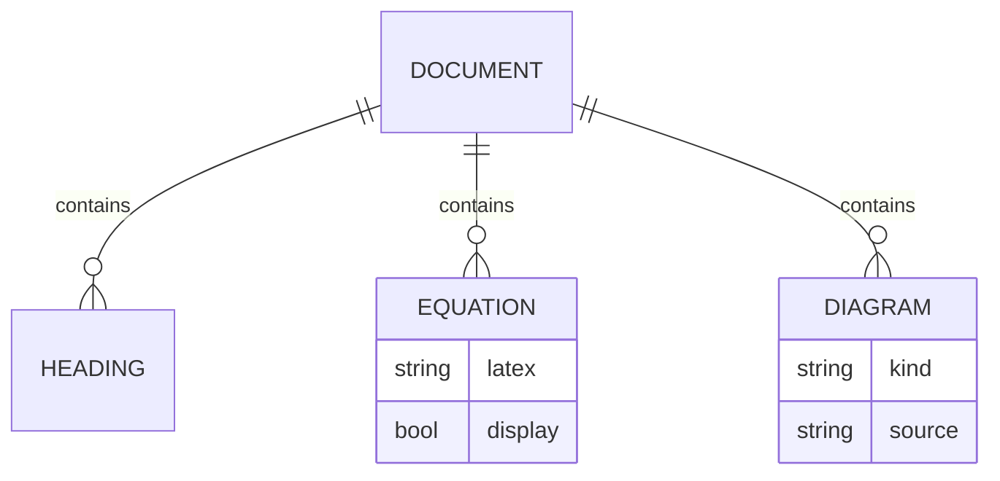
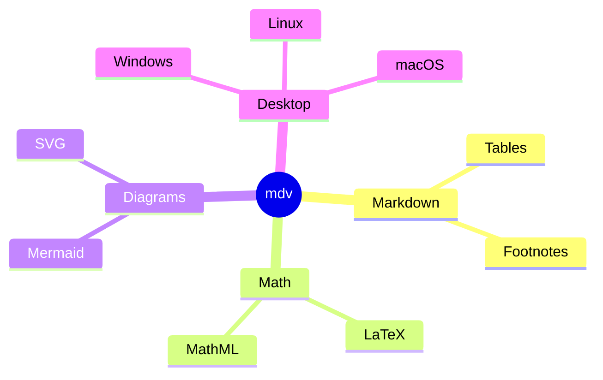
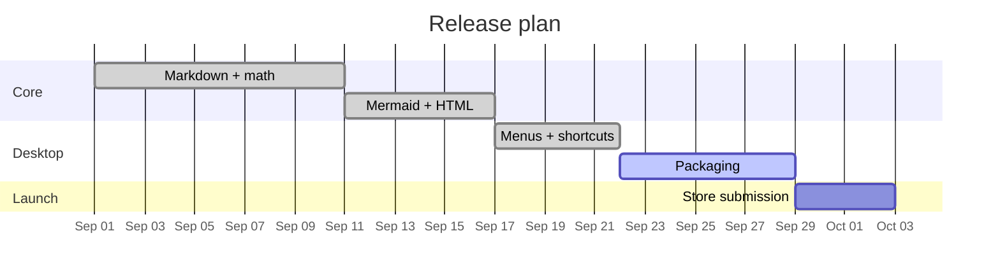

# mdv showcase

A single document that exercises everything: LaTeX and MathML equations, Mermaid diagrams, inline SVG and HTML.

---

## Part: Mathematics, beautifully typeset

Everything on this page is plain text in a `.md` file. Inline math like $e^{i\pi}+1=0$, $\sqrt{a^2+b^2}$ and $\Gamma(z)=\int_0^\infty t^{z-1}e^{-t}\,dt$ flows with the text, and display equations are centred. LaTeX is converted to **MathML**, which the system web view renders natively - no fonts or scripts are bundled.

## Analysis

$$\int_{-\infty}^{\infty} e^{-x^2}\,dx = \sqrt{\pi} \qquad\qquad \sum_{n=1}^{\infty}\frac{1}{n^2}=\frac{\pi^2}{6}$$

$$\hat{f}(\xi)=\int_{-\infty}^{\infty} f(x)\,e^{-2\pi i x\xi}\,dx \qquad\qquad \lim_{x\to 0}\frac{\sin x}{x}=1$$

$$\prod_{p\ \text{prime}}\frac{1}{1-p^{-s}}=\zeta(s) \qquad\qquad \binom{n}{k}=\frac{n!}{k!\,(n-k)!}$$

## Electromagnetism and quantum mechanics

$$\nabla\times\vec{B}=\mu_0\vec{J}+\mu_0\varepsilon_0\frac{\partial\vec{E}}{\partial t} \qquad\qquad \nabla\cdot\vec{E}=\frac{\rho}{\varepsilon_0}$$

$$i\hbar\frac{\partial}{\partial t}\Psi(\mathbf{r},t)=\left[-\frac{\hbar^2}{2m}\nabla^2+V(\mathbf{r},t)\right]\Psi(\mathbf{r},t)$$

$$\oint_C\vec{F}\cdot d\vec{r}=\iint_S(\nabla\times\vec{F})\cdot d\vec{S}$$

## Relativity and cosmology

$$G_{\mu\nu}+\Lambda g_{\mu\nu}=\frac{8\pi G}{c^4}\,T_{\mu\nu}$$

$$\mathrm{d}s^2=-c^2\mathrm{d}t^2+a(t)^2\left[\frac{\mathrm{d}r^2}{1-kr^2}+r^2\,\mathrm{d}\Omega^2\right] \qquad \left(\frac{\dot a}{a}\right)^2=\frac{8\pi G}{3}\rho-\frac{k}{a^2}$$

## Linear algebra

$$\begin{pmatrix}a&b\\c&d\end{pmatrix}\begin{pmatrix}x\\y\end{pmatrix}=\begin{pmatrix}ax+by\\cx+dy\end{pmatrix} \qquad R_x(\theta)=\begin{bmatrix}1&0&0\\0&\cos\theta&-\sin\theta\\0&\sin\theta&\cos\theta\end{bmatrix}$$

$$\det(A)=\begin{vmatrix}a&b\\c&d\end{vmatrix}=ad-bc \qquad \lVert x\rVert_2=\sqrt{\sum_i x_i^2}$$

## Probability, statistics and machine learning

$$P(A\mid B)=\frac{P(B\mid A)\,P(A)}{P(B)} \qquad \sigma^2=\frac{1}{N}\sum_{i=1}^{N}(x_i-\mu)^2 \qquad H(X)=-\sum_x p(x)\log_2 p(x)$$

$$\operatorname{softmax}(z)_i=\frac{e^{z_i}}{\sum_j e^{z_j}} \qquad \mathcal{L}(\theta)=-\sum_i y_i\log\hat{y}_i$$

| Quantity | Symbol | Formula |
|---|---|---|
| Quadratic roots | $x_{1,2}$ | $\dfrac{-b\pm\sqrt{b^2-4ac}}{2a}$ |
| Expectation | $\mathbb{E}[X]$ | $\sum_i x_i\,p_i$ |
| Euler product | $\zeta(s)$ | $\prod_p (1-p^{-s})^{-1}$ |
| Logic | $A\subseteq B$ | $\forall x\,(x\in A\to x\in B)$ |

## Raw MathML works too

Anything LaTeX can't express can be written as MathML directly. A piecewise function and a continued fraction:

<math display="block">
  <mrow><mi>f</mi><mo>(</mo><mi>x</mi><mo>)</mo></mrow><mo>=</mo>
  <mrow><mo>{</mo>
    <mtable columnalign="left left">
      <mtr><mtd><msup><mi>x</mi><mn>2</mn></msup></mtd><mtd><mtext>if&nbsp;</mtext><mi>x</mi><mo>&ge;</mo><mn>0</mn></mtd></mtr>
      <mtr><mtd><mo>&minus;</mo><mi>x</mi></mtd><mtd><mtext>otherwise</mtext></mtd></mtr>
    </mtable>
  </mrow>
  <mspace width="3em"/>
  <mi>&phi;</mi><mo>=</mo><mn>1</mn><mo>+</mo>
  <mfrac><mn>1</mn><mrow><mn>1</mn><mo>+</mo><mfrac><mn>1</mn><mrow><mn>1</mn><mo>+</mo><mfrac><mn>1</mn><mrow><mn>1</mn><mo>+</mo><mo>&hellip;</mo></mrow></mfrac></mrow></mfrac></mrow></mfrac>
</math>

---

## Part: Diagrams from plain text

Fenced ` ```mermaid ` blocks become live diagrams that follow the light / dark theme.

<div style="display:grid;grid-template-columns:repeat(3,1fr);gap:24px;align-items:start">

<div style="grid-column:span 3">



</div>

<div>



</div>

<div>



</div>

<div>



</div>

<div>



</div>

<div>



</div>

<div>



</div>

<div style="grid-column:span 2">



</div>

</div>

---

## Part: Inline SVG and HTML

Raw HTML passes straight through, so you can mix hand-drawn vector graphics, MathML and ordinary HTML elements with your Markdown.

## An architecture diagram in SVG

<svg viewBox="0 0 860 230" width="100%" style="max-width:760px;display:block;margin:0 auto" role="img" aria-label="Rendering pipeline">
  <defs>
    <linearGradient id="gA" x1="0" y1="0" x2="1" y2="1"><stop offset="0" stop-color="#2563eb"/><stop offset="1" stop-color="#7c3aed"/></linearGradient>
    <linearGradient id="gB" x1="0" y1="0" x2="1" y2="1"><stop offset="0" stop-color="#0891b2"/><stop offset="1" stop-color="#2563eb"/></linearGradient>
    <linearGradient id="gC" x1="0" y1="0" x2="1" y2="1"><stop offset="0" stop-color="#16a34a"/><stop offset="1" stop-color="#0891b2"/></linearGradient>
    <marker id="arrow" viewBox="0 0 10 10" refX="9" refY="5" markerWidth="12" markerHeight="12" markerUnits="userSpaceOnUse" orient="auto"><path d="M0 0L10 5L0 10z" fill="#64748b"/></marker>
    <filter id="sh" x="-10%" y="-10%" width="130%" height="140%"><feDropShadow dx="0" dy="3" stdDeviation="4" flood-opacity=".25"/></filter>
  </defs>
  <g font-family="system-ui, Segoe UI, sans-serif" font-size="15" fill="#fff" text-anchor="middle" filter="url(#sh)">
    <rect x="10" y="70" width="150" height="90" rx="14" fill="url(#gA)"/><text x="85" y="108" font-weight="700">Markdown</text><text x="85" y="132" font-size="12" opacity=".85">.md file</text>
    <rect x="230" y="20" width="170" height="80" rx="14" fill="url(#gB)"/><text x="315" y="55" font-weight="700">LaTeX</text><text x="315" y="78" font-size="12" opacity=".85">converted to MathML</text>
    <rect x="230" y="130" width="170" height="80" rx="14" fill="url(#gB)"/><text x="315" y="165" font-weight="700">Mermaid</text><text x="315" y="188" font-size="12" opacity=".85">text to SVG diagrams</text>
    <rect x="470" y="70" width="150" height="90" rx="14" fill="url(#gA)"/><text x="545" y="108" font-weight="700">HTML</text><text x="545" y="132" font-size="12" opacity=".85">SVG and MathML</text>
    <rect x="690" y="70" width="160" height="90" rx="14" fill="url(#gC)"/><text x="770" y="108" font-weight="700">Web view</text><text x="770" y="132" font-size="12" opacity=".85">native renderer</text>
  </g>
  <g stroke="#64748b" stroke-width="2.5" fill="none" marker-end="url(#arrow)">
    <path d="M160 105 C195 105 195 60 228 60"/><path d="M160 125 C195 125 195 170 228 170"/>
    <path d="M400 60 C435 60 435 105 468 105"/><path d="M400 170 C435 170 435 125 468 125"/>
    <path d="M620 115 L688 115"/>
  </g>
</svg>

## A chart in SVG

<svg viewBox="0 0 860 300" width="100%" style="max-width:760px;display:block;margin:0 auto" role="img" aria-label="Binary size comparison">
  <defs>
    <linearGradient id="bar" x1="0" y1="0" x2="0" y2="1"><stop offset="0" stop-color="#7c3aed"/><stop offset="1" stop-color="#2563eb"/></linearGradient>
    <linearGradient id="barHi" x1="0" y1="0" x2="0" y2="1"><stop offset="0" stop-color="#22c55e"/><stop offset="1" stop-color="#0891b2"/></linearGradient>
  </defs>
  <g font-family="system-ui, Segoe UI, sans-serif" font-size="13" fill="currentColor">
    <g stroke="currentColor" stroke-opacity=".15"><path d="M70 40H840M70 90H840M70 140H840M70 190H840M70 240H840"/></g>
    <g text-anchor="end" opacity=".7"><text x="62" y="244">0</text><text x="62" y="194">50</text><text x="62" y="144">100</text><text x="62" y="94">150</text><text x="62" y="44">200 MB</text></g>
    <rect x="120" y="226" width="90" height="14" rx="4" fill="url(#barHi)"/><text x="165" y="218" text-anchor="middle" font-weight="700">2.5 MB</text><text x="165" y="266" text-anchor="middle">mdv</text>
    <rect x="270" y="130" width="90" height="110" rx="4" fill="url(#bar)"/><text x="315" y="122" text-anchor="middle" font-weight="700">~110 MB</text><text x="315" y="266" text-anchor="middle">Electron app</text>
    <rect x="420" y="86" width="90" height="154" rx="4" fill="url(#bar)"/><text x="465" y="78" text-anchor="middle" font-weight="700">~150 MB</text><text x="465" y="266" text-anchor="middle">bundled browser</text>
    <rect x="570" y="156" width="90" height="84" rx="4" fill="url(#bar)"/><text x="615" y="148" text-anchor="middle" font-weight="700">~85 MB</text><text x="615" y="266" text-anchor="middle">Qt WebEngine</text>
    <rect x="720" y="196" width="90" height="44" rx="4" fill="url(#bar)"/><text x="765" y="188" text-anchor="middle" font-weight="700">~45 MB</text><text x="765" y="266" text-anchor="middle">Tauri + JS</text>
  </g>
</svg>

<sub>Illustrative sizes. mdv uses the operating system's web view instead of shipping a browser.</sub>

## HTML elements

<details open>
<summary><strong>Keyboard shortcuts</strong></summary>

| Action | Shortcut |
|---|---|
| Open file | <kbd>Ctrl</kbd> + <kbd>O</kbd> |
| Find | <kbd>Ctrl</kbd> + <kbd>F</kbd> |
| Zoom in / out | <kbd>Ctrl</kbd> + <kbd>+</kbd> / <kbd>-</kbd> |
| Reload | <kbd>F5</kbd> |
| Print / save as PDF | <kbd>Ctrl</kbd> + <kbd>P</kbd> |

</details>

Highlighted <mark>text</mark>, H<sub>2</sub>O, E = mc<sup>2</sup>, <abbr title="Scalable Vector Graphics">SVG</abbr>, and an <progress value="72" max="100" style="vertical-align:middle">72%</progress> progress bar - all plain HTML.

## MathML in HTML

<math display="block" xmlns="http://www.w3.org/1998/Math/MathML">
  <mi>x</mi><mo>=</mo>
  <mfrac>
    <mrow><mo>&minus;</mo><mi>b</mi><mo>&pm;</mo><msqrt><msup><mi>b</mi><mn>2</mn></msup><mo>&minus;</mo><mn>4</mn><mi>a</mi><mi>c</mi></msqrt></mrow>
    <mrow><mn>2</mn><mi>a</mi></mrow>
  </mfrac>
  <mspace width="3em"/>
  <munderover><mo>&sum;</mo><mrow><mi>k</mi><mo>=</mo><mn>0</mn></mrow><mi>n</mi></munderover>
  <msup><mi>r</mi><mi>k</mi></msup><mo>=</mo>
  <mfrac><mrow><mn>1</mn><mo>&minus;</mo><msup><mi>r</mi><mrow><mi>n</mi><mo>+</mo><mn>1</mn></mrow></msup></mrow><mrow><mn>1</mn><mo>&minus;</mo><mi>r</mi></mrow></mfrac>
</math>

## Animated SVG

<svg viewBox="0 0 860 150" width="100%" style="max-width:760px;display:block;margin:0 auto" role="img" aria-label="Orbiting dots">
  <g transform="translate(430 75)">
    <circle r="22" fill="#7c3aed"/>
    <g fill="none" stroke="currentColor" stroke-opacity=".25"><ellipse rx="120" ry="40"/><ellipse rx="220" ry="62"/><ellipse rx="330" ry="70"/></g>
    <circle r="9" fill="#22c55e"><animateMotion dur="4s" repeatCount="indefinite" path="M-120 0A120 40 0 1 0 120 0A120 40 0 1 0 -120 0"/></circle>
    <circle r="11" fill="#2563eb"><animateMotion dur="7s" repeatCount="indefinite" path="M-220 0A220 62 0 1 0 220 0A220 62 0 1 0 -220 0"/></circle>
    <circle r="8" fill="#f59e0b"><animateMotion dur="11s" repeatCount="indefinite" path="M-330 0A330 70 0 1 0 330 0A330 70 0 1 0 -330 0"/></circle>
  </g>
</svg>

